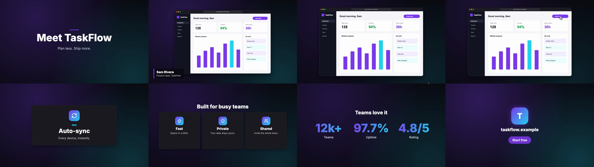
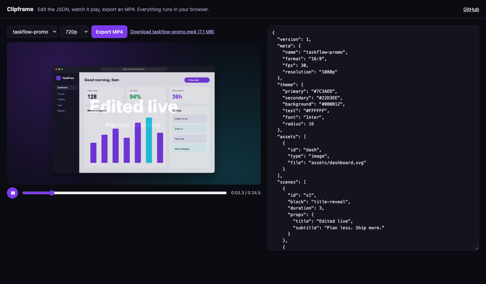

# Clipframe

**Make videos from JSON.** Clipframe is a free, MIT-licensed alternative to Remotion for data-driven and AI-made videos: product promos, launch films, social reels, explainers. It includes a canvas renderer, real **HTML, CSS and Tailwind** scenes, 20 prebuilt animation blocks, video and audio, a player, MP4 export in the browser and a command-line renderer.

```bash
npx clipframe init my-video
npx clipframe render my-video/project.json      # → my-video/taskflow-promo.mp4
```


- **Free for everyone.** It uses the MIT license, including commercial use at any company size. There are no seat licenses or render fees.
- **JSON in, MP4 out.** A video is a list of scenes, each a block plus its props. People can write it by hand, apps can generate it, and an AI can write it in a few hundred tokens instead of thousands of lines of animation code.
- **Preview matches export.** The player and the exporter call the same `renderFrame`, so the file shows exactly what you saw.
- **Renders anywhere Chrome runs.** It exports in the browser with WebCodecs (no server), or from the command line with headless Chrome.
- **HTML, CSS and Tailwind in the video.** Use flexbox, grid, gradients, 3D transforms, web fonts and `@keyframes` animations, captured frame by frame on the video's clock. You can also write blocks whose HTML comes from code (React works too). See [HTML in video](docs/html.md).
- **Video, music, voice-over and sound effects,** with the music ducking under speech and clip sound.
- **Extensible.** A custom block is one small JavaScript file: a schema plus either a canvas draw function or an HTML function.

## Is it a Remotion replacement?

It does the same job (code-defined video, a preview player, rendering to MP4) and covers Remotion's everyday features, but it is **not a drop-in replacement**. Remotion projects need porting. Here is where each one stands:

| | Remotion | Clipframe |
|---|---|---|
| You write | React components (HTML / CSS) | JSON scenes using blocks, HTML/CSS/Tailwind, or code that returns HTML or draws on a canvas |
| License | Free for individuals and small teams; companies need a paid license | MIT, free for everyone |
| HTML, CSS and Tailwind in the video | ✅ | ✅ ([no scripts inside the HTML](docs/html.md#limits); logic goes in code blocks) |
| CSS `@keyframes` on the video clock | ✅ | ✅ |
| React components | ✅ (native, with hooks) | ✅ via `renderToStaticMarkup` (animate from `t`, no hooks state) |
| Animation helpers (`interpolate`, `spring`, easing) | ✅ | ✅ (similar API, in seconds) |
| Player component | ✅ | ✅ (plain JS or React) |
| Render in the user's browser | Limited | ✅ (WebCodecs) |
| Render from the command line | ✅ | ✅ (headless Chrome) |
| Cloud / Lambda rendering | ✅ | ❌ (run the CLI on your own server) |
| Video clips, music, voice-over, sound effects, music ducking | ✅ | ✅ |
| Prebuilt promo blocks (UI mockups, cursor clicks, pricing, stats…) | Templates (some paid) | ✅ 20 built-in |
| Cost of having an AI make a video | High (it writes code) | Low (it writes JSON) |

Choose Remotion if you need cloud rendering, live interactive components (`<video>`, `<iframe>`, client-side scripts) inside frames, or its plugin ecosystem. Choose Clipframe if you want HTML/CSS or structured videos made by people, apps or AI, with no license questions.

## A project

```json
{
  "version": 1,
  "meta": { "name": "launch", "format": "16:9", "fps": 30, "resolution": "1080p" },
  "theme": { "primary": "#7C3AED", "secondary": "#22D3EE", "background": "#0B0B12", "text": "#FFFFFF", "font": "Inter", "radius": 16 },
  "assets": [{ "id": "shot", "type": "image", "file": "assets/dashboard.png" }],
  "scenes": [
    { "id": "s1", "block": "title-reveal", "duration": 3, "props": { "title": "Meet TaskFlow", "subtitle": "Plan less. Ship more." } },
    { "id": "s2", "block": "ui-mockup", "duration": 4, "props": { "asset": "shot", "frame": "browser" }, "transition": { "type": "slide", "duration": 0.5 } },
    { "id": "s3", "block": "logo-outro", "duration": 3, "props": { "text": "TaskFlow", "cta": "taskflow.app" } }
  ],
  "overlays": [{ "id": "o1", "block": "lower-third", "start": 3.5, "end": 6.5, "props": { "title": "Sam Rivera", "subtitle": "Product lead" } }]
}
```

- **Formats:** 16:9, 9:16, 1:1, 4:5 and 4:3, at 720p or 1080p and 30 or 60 fps.
- **Transitions:** fade, slide, zoom and wipe.
- **Theme:** brand colours, font and corner radius, applied to every block.
- **Fonts included:** Inter, Poppins, Hind Siliguri and Noto Sans Bengali. Latin and Bangla text both render correctly.

The full format is in [docs/project-format.md](docs/project-format.md), and every block with its props is in [docs/blocks.md](docs/blocks.md). Running `clipframe schema` prints the JSON Schema.



## Blocks

| Group | Blocks |
|---|---|
| HTML | `html` (scene), `html-overlay` (over the scenes): any HTML + CSS + Tailwind. See [docs/html.md](docs/html.md) |
| Media | `video`, `picture` |
| Text | `title-reveal`, `kinetic-text` |
| UI | `ui-mockup` (browser / phone / laptop), `cursor-click`, `zoom-pan`, `feature-callout`, `feature-grid` |
| Data | `stats-counter`, `before-after`, `pricing-card` |
| Brand | `testimonial`, `logo-outro` |
| Background | `background` |
| Overlays | `lower-third`, `captions`, `watermark` |

## HTML scenes

```json
{ "id": "s1", "block": "html", "duration": 4, "props": {
  "tailwind": true,
  "html": "<div class=\"h-full grid place-items-center\"><h1 class=\"rise text-[140px] font-extrabold\">Hello <span class=\"text-violet-400\">HTML</span></h1></div>",
  "css": ".rise{animation:rise .8s both}@keyframes rise{from{opacity:0;transform:translateY(60px)}}"
} }
```


Lay out at 1080p size. `@keyframes` play on the video clock, `var(--t)` and `var(--p)` give the time and progress, `src="asset:ID"` uses project images, and web fonts load from a stylesheet URL. Full guide: [docs/html.md](docs/html.md). Example: [examples/html-css](examples/html-css).

## Install

```bash
npm i clipframe
```

Node 20 or newer. Rendering needs Google Chrome or Edge installed. If you have neither, run `npx playwright install chromium` and Clipframe uses that instead.

> Clipframe has not been published to npm yet. Until it is, clone this repo and run `npm install && npm run build && npm link`.

## Command line

```bash
clipframe render project.json -o out.mp4          # MP4, H.264 + AAC
clipframe render project.json --resolution 720p --fps 60
clipframe render project.json --from 3 --to 8      # only part of it
clipframe still project.json -t 2.5 -o frame.png   # one frame (PNG, JPEG or WebP)
clipframe validate project.json                    # check it before rendering
clipframe blocks                                   # list blocks
clipframe blocks title-reveal                      # one block's props
clipframe schema                                   # project JSON Schema
clipframe render project.json --blocks my-block.js # with your own blocks
```

Asset files are read relative to the folder `project.json` is in.

## In the browser

```ts
import { assetsFrom } from "clipframe";
import { createPlayer } from "clipframe/player";
import { renderToMp4 } from "clipframe/export";

const player = createPlayer(document.getElementById("player")!, {
  project,
  resolveAsset: assetsFrom("/my-video/"), // where project files live
  fontsUrl: "/fonts", // copy node_modules/clipframe/fonts here
});

const blob = await renderToMp4(project, {
  resolveAsset: assetsFrom("/my-video/"),
  onProgress: (p) => console.log(p.frame, "/", p.total),
});
```

React:

```tsx
import { ClipframePlayer } from "clipframe/react";

<ClipframePlayer project={project} resolveAsset={assetsFrom("/my-video/")} loop />;
```

Browser export needs WebCodecs (Chrome or Edge 94+). Safari and Firefox can play videos but not export them yet.

## Your own blocks

```js
// countdown.js
export default ({ z, defineBlock, font, spring, drawBackdrop }) =>
  defineBlock({
    id: "countdown",
    name: "Countdown",
    summary: "Numbers count down to a launch message",
    category: "text",
    defaultDuration: 4,
    schema: z.object({ from: z.number().int().default(3) }),
    render(r) {
      const { ctx, props, theme, t, width, height, unit } = r;
      drawBackdrop(r);
      const n = Math.max(0, props.from - Math.floor(t));
      const s = spring(t % 1);
      ctx.fillStyle = theme.text;
      ctx.font = font(800, 360 * unit * s, theme.font);
      ctx.textAlign = "center";
      ctx.textBaseline = "middle";
      ctx.fillText(String(n), width / 2, height / 2);
    },
  });
```

Or return HTML instead of drawing: `defineHtmlBlock({ ..., html: (props, f) => \`<div>${f.t}</div>\` })` ([docs/html.md](docs/html.md#in-code-definehtmlblock-remotion-style)).

`render` is called once per frame with the time `t` in seconds. It has to be pure, so the same `t` always draws the same pixels. That is why preview and export match. See [docs/custom-blocks.md](docs/custom-blocks.md) and [examples/custom-block](examples/custom-block).

## Made for AI

- `compactBlockList(registry)` describes every block in one line each. Hand that to a model as its menu.
- `applyOps(project, ops)` applies small edits such as `add_scene`, `update_scene` and `set_theme` atomically, and validates the result.
- `validateProject` returns short, fixable errors like `s3.props.title: required`, which a model can correct on its next turn.
- `summary(project)` gives a compact text view of a project.

Clipframe is the rendering engine of [Clipai](https://github.com/ferdousmikdad/Clipai), a local AI video editor that adds a timeline, captions and footage editing on top of it.

## Playground

```bash
npm install
npm run demo
```

The playground lets you pick an example, edit its JSON and watch the preview update live, then export an MP4 in the browser.



## Develop

```bash
npm install
npm run build     # library + CLI render page
npm test          # unit tests
npm run typecheck
npm run docs      # regenerate docs/blocks.md
```

Layout: `src/schema` (project format, timing, ops), `src/engine` (renderer, easing, motion, drawing helpers), `src/blocks`, `src/html` (HTML → frame), `src/player`, `src/react`, `src/export` (WebCodecs + MP4), `src/cli`.

`CLIPFRAME_DEBUG=1 clipframe still …` saves the SVG of each HTML frame next to the output, for inspecting.

## License

MIT © Ferdous Mikdad. The bundled fonts use the SIL Open Font License, the icons are Lucide (ISC), and the dependencies keep their own licenses. See [THIRD_PARTY_NOTICES.md](THIRD_PARTY_NOTICES.md).
